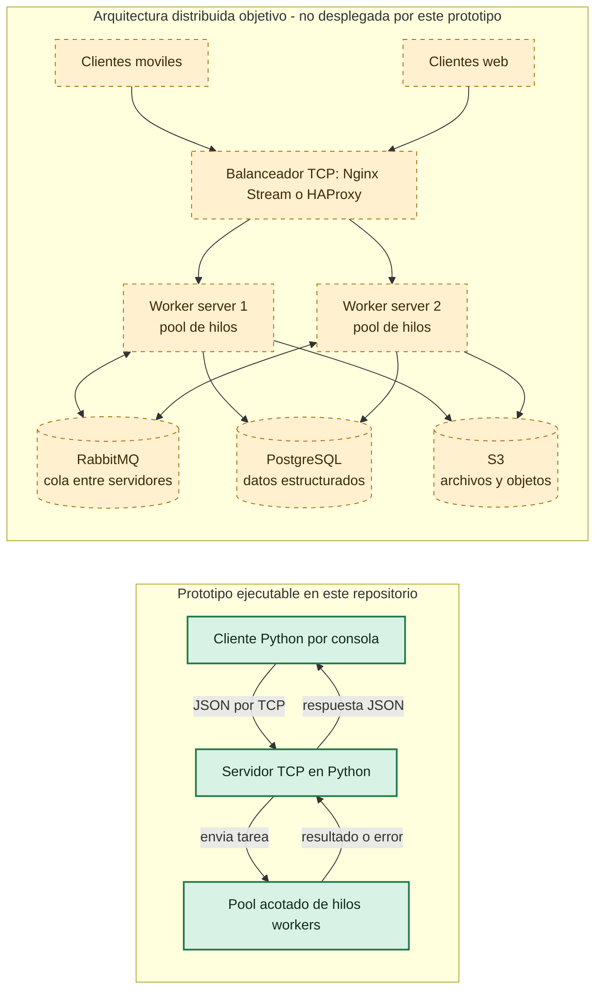

# Arquitectura del sistema

El diagrama muestra la arquitectura distribuida objetivo y separa lo que ejecuta esta entrega de los componentes planteados para un despliegue distribuido completo.

## Componentes

| Componente | Rol | Estado en esta entrega |
| --- | --- | --- |
| Cliente Python | Envía una tarea y espera la respuesta por TCP | Implementado |
| Servidor TCP | Recibe mensajes JSON y coordina su procesamiento | Implementado |
| Pool de hilos | Ejecuta tareas en paralelo con un limite de workers | Implementado |
| Nginx Stream o HAProxy | Distribuye conexiones TCP entre instancias | Arquitectura objetivo |
| RabbitMQ | Coordina trabajo asincrono entre servidores | Arquitectura objetivo |
| PostgreSQL | Persiste datos estructurados compartidos | Arquitectura objetivo |
| S3 | Almacena archivos u objetos compartidos | Arquitectura objetivo |

El prototipo no necesita servicios externos: modela la distribucion local con sockets TCP y un `ThreadPoolExecutor`. Para escalarlo, se desplegarian varias instancias del servidor detras del balanceador y se agregarian RabbitMQ y almacenamiento compartido.
